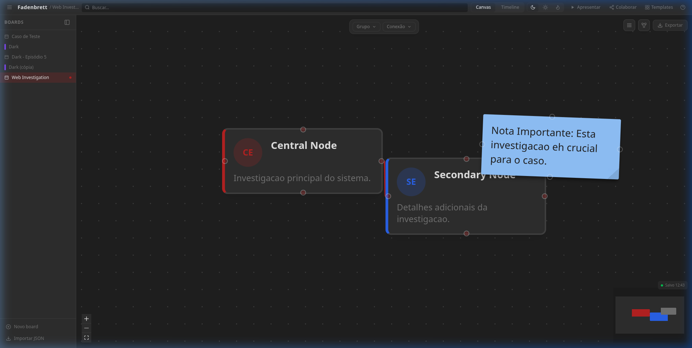
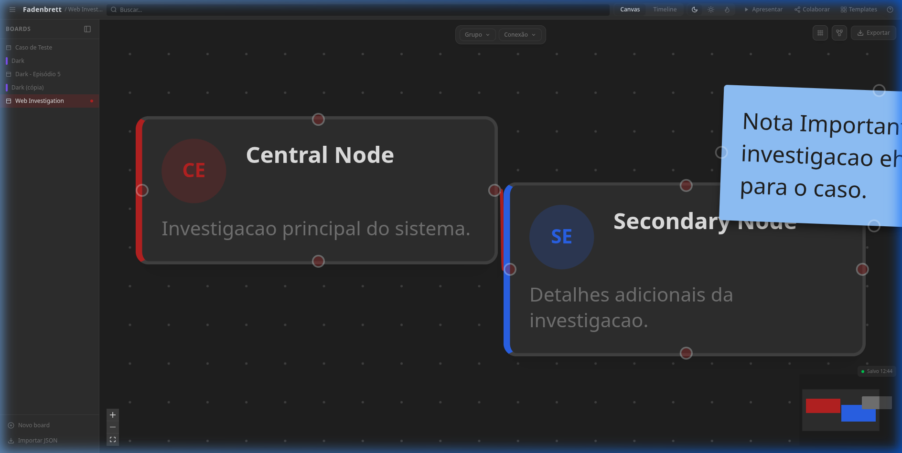
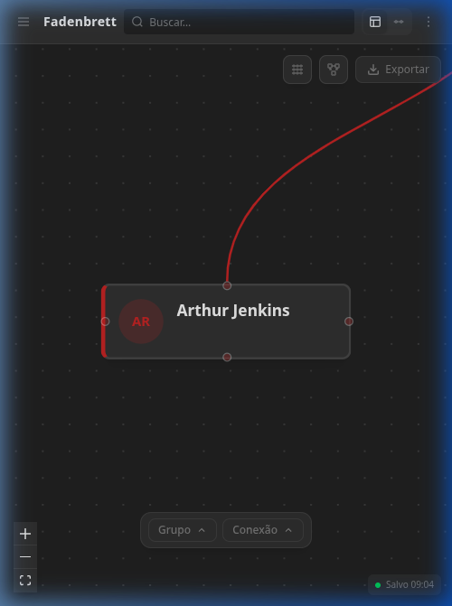
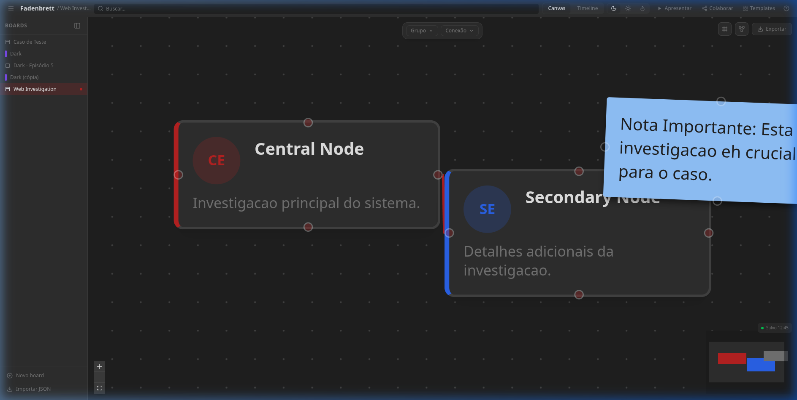
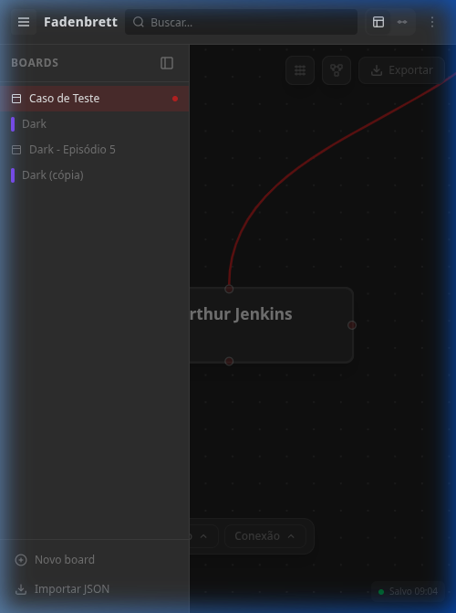

# Fadenbrett

**Follow the red thread. Connect the clues.**

A self-hosted, open-source digital investigation board. Inspired by the detective boards from films and TV shows: connect characters, events and theories with red strings on an infinite canvas.

[](https://github.com/raniellimontagna/fadenbrett/actions/workflows/ci.yml)
[](https://github.com/raniellimontagna/fadenbrett/releases)
[](LICENSE)

> *Fadenbrett* is German: **Faden** (thread) + **Brett** (board). The name nods to the *roter Faden* (the common thread) and to the red strings on the investigation boards of shows like *Dark*.



The interface is in Brazilian Portuguese.

## Features

**Building the board**
- Infinite canvas with pan and zoom.
- Entity cards for people, places or evidence: emoji or initials avatar, an uploaded image, a Markdown description, tags, an era label, a group color and custom fields (text, number, date, yes/no, link).
- Red-string connections with labels, relationship presets (family, romance, suspect, ally, enemy, unknown), solid, dashed or dotted lines, curved, straight or stepped routing, adjustable curvature and direction arrows. Drag an end to reconnect it.
- Sticky notes for quick hypotheses.
- Frames to group an area of the board under a title and color.
- Starter templates based on *Dark*, *Lost* and *Breaking Bad*.

**Organizing**
- Multiple boards per instance, each with its own name, description and color; duplicate a board in one click.
- Filters by group, tag and era that dim everything else, so the context stays visible.
- Timeline view that lays the cards out in columns by era.
- Auto-layout with force-directed, hierarchical or radial arrangements.
- Layer order (bring to front, send to back) and draggable ruler guides.
- Copy and paste, undo and redo (last 50 steps), and autosave.
- Command palette (`Ctrl/Cmd + K`) and a keyboard shortcuts overlay (`?`).
- Dark, light and custom themes.

**Sharing**
- Real-time collaboration over WebSockets, with presence and remote cursors.
- Presentation mode: walk others through the investigation along a path of stops on the canvas.
- Export a board as PNG or JPG (1x, 2x or 4x) or as JSON, and import it back from JSON.

| Desktop | Mobile |
| --- | --- |
|  |  |
|  |  |

## Self-hosting

Fadenbrett runs entirely on your own machine: the boards live in a SQLite database and the uploaded images in a local folder, with no telemetry and no external service.

There are no user accounts or sign-in. Anyone who can reach the server can read and edit every board, so keep it on a trusted network or put it behind your own authentication proxy.

### Docker (recommended)

```bash
git clone https://github.com/raniellimontagna/fadenbrett.git
cd fadenbrett/deploy
cp .env.example .env   # optional: change PORT (default 80)
docker compose up -d --build
```

Open `http://localhost`. Nginx serves the web app and proxies `/api`, `/uploads` and `/ws` to the API container; the database and uploads persist in the `data` volume.

### Proxmox VE (LXC)

Run on the Proxmox host shell:

```bash
bash <(curl -fsSL https://raw.githubusercontent.com/raniellimontagna/fadenbrett/main/scripts/proxmox/install.sh)
```

The installer creates an LXC container and builds the stack from source. Defaults can be overridden with environment variables (`CT_ID`, `CT_RAM`, `FADENBRETT_PORT` and others; see the top of [`install.sh`](scripts/proxmox/install.sh)). To update an existing container later:

```bash
CT_ID=200 bash <(curl -fsSL https://raw.githubusercontent.com/raniellimontagna/fadenbrett/main/scripts/proxmox/update.sh)
```

## Tech stack

| Layer | Technology |
| --- | --- |
| Front end | React 19, Vite, TypeScript, Tailwind CSS v4, Zustand, React Flow, ELK (auto-layout) |
| Back end | Fastify, Drizzle ORM, SQLite (better-sqlite3) |
| Real time | WebSockets (`@fastify/websocket`) |
| Infrastructure | Docker, Docker Compose, Nginx, Proxmox LXC scripts |

## Development

Prerequisites: Node.js 22 and [pnpm](https://pnpm.io). `better-sqlite3` may need build tools (Python, make and a C++ compiler) when no prebuilt binary matches your platform.

```bash
pnpm install
pnpm dev:api   # API on http://localhost:3001 (SQLite in apps/api/data/sqlite/)
pnpm dev       # web app on http://localhost:3000, in a second terminal
```

The web app calls the API at `http://localhost:3001` unless `VITE_API_URL` says otherwise.

| Script | What it does |
| --- | --- |
| `pnpm dev` | Start the web app (Vite) |
| `pnpm dev:api` | Start the API in watch mode (tsx) |
| `pnpm build` | Build the web app and the API (`build:web` and `build:api` build one each) |
| `pnpm lint` | Lint the web app (ESLint) |
| `pnpm type-check` | Type-check the web app and the API |
| `pnpm test` | Run the API integration tests (Vitest) |

## Project structure

```text
apps/
  web/           React front end; one folder per feature in src/features
                 (canvas, cards, connections, notes, frames, filters, presentation, collab, templates, command-palette)
  api/           Fastify API: boards, cards, notes, connections, uploads and the /ws collaboration rooms
deploy/          Docker Compose stack (Nginx + API)
scripts/proxmox/ LXC install and update scripts
docs/images/     screenshots
```

See [CHANGELOG.md](CHANGELOG.md) for release notes.

## License

Released under the [MIT License](LICENSE).
